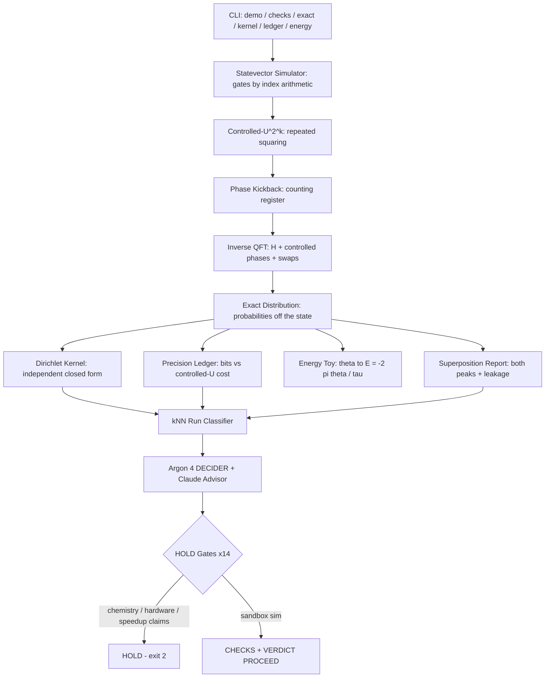
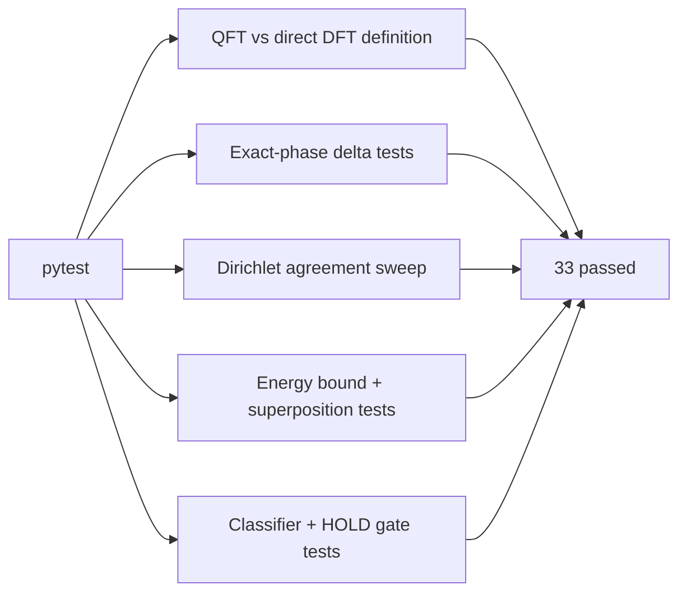
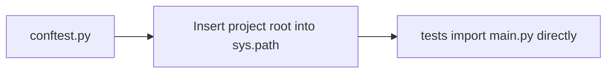
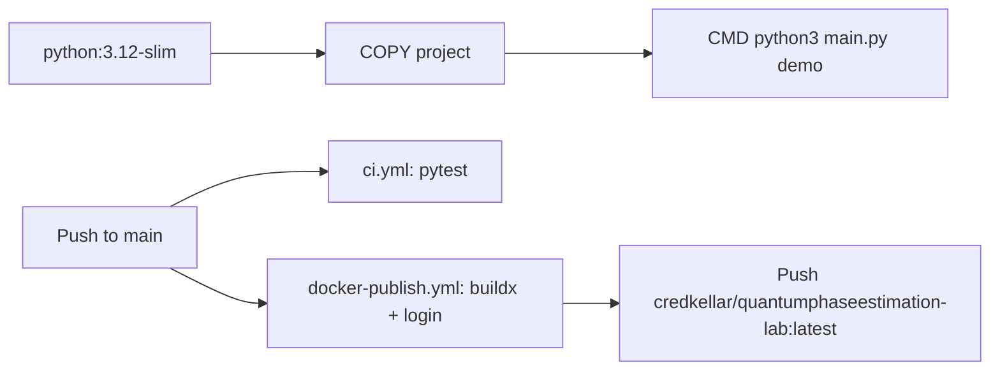

# QuantumPhaseEstimation-Lab 🎛️⚛️

**Quantum Phase Estimation Lab** — by Darion Kellar

QuantumPhaseEstimation-Lab is an **educational quantum phase estimation (QPE) lab** in ONE pure-Python file. It builds the whole algorithm from scratch on a classical statevector simulator — no quantum library, no sampling, no hidden randomness:

- A **counting register** of t qubits, Hadamards, and **controlled-U^(2^k)** gates built as exact matrix powers, so the eigenphase of U lands on the register by **phase kickback**. 🎛️
- An **inverse QFT** assembled from Hadamards, controlled phases, and swaps — and **graded against the direct DFT definition** in the checks before it is trusted. 🔍
- Outcome probabilities read **exactly off the final statevector**: when theta sits on the 2^t grid the distribution is a delta (probability **1.000000**); when it sits off-grid, the peak follows the **Dirichlet kernel** and the simulator matches that formula to **~1e-15**. 📐
- A **precision ledger** that prints the cost next to every accuracy claim: t bits of phase cost **2^t − 1 controlled-U applications** — 255 of them at t = 8. 🧾

Honest scope, stated up front: the phases belong to **labelled toy unitaries**, the "energy" in the application section is a labelled conversion `E = −2πθ/τ`, and the simulator is classical — it pays **2^n amplitudes** (512 at t = 8) for everything it does. No molecule's energy was computed, no quantum hardware ran, and no speedup is claimed. Every chemistry / hardware / cryptography claim sits behind a permanent HOLD gate (14 total). 🔒

[](https://github.com/kimanicollier44-cmyk/QuantumPhaseEstimation-Lab/actions/workflows/ci.yml)
[](https://github.com/kimanicollier44-cmyk/QuantumPhaseEstimation-Lab/actions/workflows/docker-publish.yml)

> ℹ️ These are the **live** workflow badges for this repo. They activate as soon as the `ci.yml` and `docker-publish.yml` files from the paste pack are pasted into `.github/workflows/` — until then they have nothing to report yet.

## 🧰 Tech Stack Badges & Full Architecture Tech Stack

### 💻 Core Programming Languages & Core Systems


- 🐍 Python 3.12, pure standard library (`cmath`, `math`, `hashlib`, `json`, `sys`) — zero dependencies, zero network, deterministic (double-run byte-identical)
- 🎛️ Quantum core: a from-scratch statevector simulator (single-qubit, controlled-2×2, controlled-phase, and swap gates by index arithmetic), controlled-U^(2^k) by repeated squaring, and an inverse QFT graded against the direct DFT definition in CHECKS
- 📐 Analysis core: the Dirichlet kernel `P = (1/2^(2t)) · sin²(2^t πδ) / sin²(πδ)` evaluated independently of the simulator and compared peak-by-peak; the rotation eigenphase recovered from the trace `α = arccos(tr/2)`
- 🧠 TinyML kNN run classifier (from scratch, stdlib): exact / confident / leaky / under-resolved from (t, distance-to-grid in cells, peak probability), labels from the lab's own policy
- 🪑 Council seats: Gemini Argon 4 DECIDER (names-only, tighten-only) + Muse advisor (never overrides HOLD) + Google Flow plan-only (rendered = False, live = 0)

### ⛓️ Web3 & Infrastructure

- 🚫 **Not applicable — honestly.** No blockchain, no Web3, no tokens: the "infrastructure" in this lab is a simulated counting register and a fractions-free phase readout inside one offline file. Cryptographic use is a permanent HOLD gate, not a feature. No fake badges here.

### ⚙️ Platform Support & Hardware Architecture


- 🖥️ Pure Python — runs anywhere Python 3.12+ runs (Linux, macOS, Windows), plus the `python:3.12-slim` Docker image
- 🔒 No quantum hardware is touched, ever: real QPUs, cloud quantum services, and cryogenic plant are permanent HOLD gates (see the gate table below)

### ⚡ Low-Level Infrastructure & Performance

- 🚫 **No low-level code — honestly.** No C, no C++, no GPU, no compiled extensions: this is one interpreted Python file on purpose, so every amplitude can be read, checked, and diffed. Performance here means honest counting — the simulator's own exponential cost (2^(t+1) amplitudes) is printed in the ledger wherever a size appears, and it is never merged with the gate-count story into a "speedup" headline.

### 🛠️ DevOps & Build Tools


- 🐳 Docker (`python:3.12-slim`), GitHub Actions CI + Docker Publish (delivered in the paste pack)
- 🎯 Target image: `credkellar/quantumphaseestimation-lab:latest`
- 🧪 Tests: `pytest` (33 tests) + the built-in CHECKS suite (46 checks) in `main.py`

### ☁️ Cloud Providers

- 🚫 **None — honestly.** No cloud provider is used or needed: the lab runs fully offline on your own machine or in a local Docker container. Docker Hub appears only as the registry the publish workflow pushes the image to.

## What this does?

1. 🎛️ **The circuit, from scratch** — a statevector simulator with single-qubit, controlled, controlled-phase, and swap gates applied by index arithmetic. Counting qubit k controls **U^(2^k)**, built by repeated squaring of the 2×2 unitary — exact matrix powers, no eigensolver, no library.
2. 🔍 **The inverse QFT, graded before trusted** — the QFT circuit (Hadamards, controlled phases, swaps) is checked against the **direct DFT definition** on every basis state at t = 3, forward and inverse, to < 1e-12 — the same style of grading the lab then applies to its own results.
3. 🎯 **Exact phases give delta functions** — with theta = 13/32 at t = 5, the measured distribution is outcome **13 with probability 1.000000** and 0.000000 everywhere else: a whole number of turns per controlled power makes the inverse QFT interfere onto exactly one cell. Theta = 0 and theta = 6/16 check the same way.
4. 📐 **Off-grid phases obey the Dirichlet kernel** — sweep theta off the grid and the peak probability is `P = (1/2^(2t)) · sin²(2^t πδ) / sin²(πδ)`. The simulator is graded against that closed form at five (t, theta) pairs — worst disagreement **4.7e-15**. At the worst offset (half a cell), the peak still holds **≥ 4/π² ≈ 0.405** of the mass.
5. 🎲 **Within-1-cell probabilities, tabled honestly** — for theta = 0.3, the probability of landing within one cell of the truth runs **0.836857 (t = 3), 0.930739 (t = 4), 0.827948 (t = 5), 0.929893 (t = 6), 0.827395 (t = 7), 0.929840 (t = 8)**. It oscillates with the fractional offset — what shrinks monotonically is the cell size, and the lab says so instead of smoothing the table.
6. 🧾 **The precision ledger** — each row prices the accuracy: t = 3 → grid 0.125, 7 controlled-U applications, 16 simulator amplitudes; t = 8 → grid **0.00390625**, **255** controlled-U applications, 28 inverse-QFT controlled phases, **512** amplitudes. Every extra bit halves the grid and roughly doubles the bill.
7. 🔋 **Toy application: an eigenphase as a labelled "energy"** — a rotation unitary's eigenphase is recovered from its trace (theta = 0.111408 for alpha = 0.7 rad) and converted with the labelled scale `E = −2πθ/τ`, τ = 0.5, so E_true = **−1.400000**. The estimate's error goes **0.170796 (t = 3–5) → 0.025553 (t = 6) → 0.023534 (t = 8)**, inside the grid bound at every t — the bound itself halving from 1.570796 to **0.049087**. A toy Hamiltonian stand-in, labelled as one — not chemistry.
8. 👥 **Non-eigenstate inputs, leakage printed** — feed |+⟩ to the phase unitary and QPE returns **both** eigenphases: 0.500064 at outcome 0 and 0.437584 at the theta peak (Born weights ½ and ½, each wearing its own peak shape; 0.977249 of the mass sits within one cell of either peak). Feed |0⟩ to the rotation and the two peaks land at outcomes 7 and 57 with **0.472807 each** — theta and 1 − theta, equal weight.
9. 🏷️ **Run classifier + seats + checks** — a from-scratch kNN labels runs exact / confident / leaky / under-resolved from features **measured by the simulator itself** (the exact run → exact; theta = 0.3 at t = 6 → confident; the same phase at t = 3 → under-resolved; a superposition input half a cell off-grid → leaky, peak spread to 0.202836), with Argon 4 DECIDER (sha256 trace), Muse advisor, Google Flow plan-only, and a built-in CHECKS suite (46 checks).

## 🗺️ How it works — diagram per script

### `main.py` — the whole lab



### `tests/test_main.py` — verification



### `conftest.py` — test path setup



### `Dockerfile` + CI flow — container & publish



## Why is this cool?

1. 🎯 The exact case is *exact*: theta on the grid gives probability **1.000000** on one outcome and zero elsewhere — interference you can verify to the last digit, not a histogram that "looks peaked".
2. 📐 The lab grades itself against a closed form: the Dirichlet kernel predicts every off-grid peak, and the simulator agrees to **~1e-15** — the quantum algorithm and the classical Fourier analysis check each other.
3. 🧾 Precision has a price tag: the ledger shows 7 controlled-U applications buying a 0.125 grid at t = 3 and 255 buying 0.00390625 at t = 8 — the exponential bargain at the heart of QPE, in one table.
4. 🎲 The honest table oscillates: within-1-cell probability for theta = 0.3 bounces between 0.827 and 0.931 instead of marching upward, because it depends on the fractional offset — and the lab prints it that way.
5. 🔋 The error bar is a theorem, not a vibe: the toy-energy estimate stays inside the grid bound at every t while the bound halves 1.570796 → 0.049087.
6. 👥 QPE doesn't pick favourites: a superposition input returns both eigenphases with their Born weights (0.472807 and 0.472807), leakage included — the failure mode is a feature you can measure.
7. 🔍 The QFT is graded against the DFT definition itself before a single phase is estimated — trust is earned in the checks, not asserted in the prose.
8. 🧮 The eigenphase of the rotation is recovered from its **trace** — arccos(tr/2) — the same trick that makes the energy toy self-contained: no eigenvalue solver anywhere in the file.
9. 🏷️ The classifier's features are measured, not hand-fed: each scenario's (t, delta, peak) triple comes out of an actual simulator run, and the kNN is asserted against the policy on all 1,155 grid rows.
10. 🎯 Deterministic end to end: run it twice, get byte-identical output — a phase estimation you can diff.

## What problems this solves?

1. ❌ **Problem:** QPE is usually taught with sampled histograms, so the readout looks like luck. ✅ **Solution:** The full distribution is read off the statevector exactly — the delta at 13/32 and every Dirichlet peak are numbers, not samples.
2. ❌ **Problem:** "More qubits = more precision" is quoted without the cost. ✅ **Solution:** The precision ledger prints grid spacing, controlled-U count (2^t − 1), inverse-QFT phases, and simulator amplitudes side by side for t = 3..8.
3. ❌ **Problem:** Off-grid behaviour is hand-waved as "some leakage". ✅ **Solution:** Leakage has a closed form — the Dirichlet kernel — and the simulator is graded against it at five points to ~1e-15, with the worst-case floor 4/π² stated.
4. ❌ **Problem:** Textbook QPE silently assumes an eigenstate input. ✅ **Solution:** The superposition section runs non-eigenstate inputs and prints both peaks and the leaked mass (0.977249 within one cell of either peak; the rest is shown, not hidden).
5. ❌ **Problem:** Phase-to-energy conversions get presented as chemistry. ✅ **Solution:** The conversion `E = −2πθ/τ` is labelled a toy scale with a labelled τ, the unitary is a rotation matrix, and `molecular_energy_claim` is a permanent HOLD gate.
6. ❌ **Problem:** Simulator demos quietly imply quantum hardware ran. ✅ **Solution:** The amplitude bill (2^(t+1)) is printed in the ledger, and `quantum_hardware_run_claim` / `quantum_speedup_claim` are HOLD gates.
7. ❌ **Problem:** Error bars are attached after the fact, if at all. ✅ **Solution:** The grid bound is computed per t and the estimate's actual error is asserted inside it at every row of the energy table.
8. ❌ **Problem:** The within-1-bit success probability is quoted as a single magic constant. ✅ **Solution:** It is computed per t for a fixed theta and shown oscillating (0.827–0.931) with the fractional offset — the dependence is the lesson.
9. ❌ **Problem:** Classifier demos label hand-picked numbers. ✅ **Solution:** Scenario features are measured from real runs, and kNN-vs-policy agreement is asserted on the entire 1,155-row training grid in CHECKS.
10. ❌ **Problem:** Algorithm demos imply production readiness. ✅ **Solution:** 14 named HOLD gates return exit code 2 for every chemistry, hardware, cryptography, benchmark, or production-solver claim, forever.

## How to install this?

1. 📋 Clone or download this project folder.
2. 🐍 Make sure Python 3.12+ is installed: `python3 --version`
3. ▶️ Run the full demo + checks (no arguments needed):

```bash
python3 main.py
```

4. 🧪 Run the test suite:

```bash
pip install pytest
python3 -m pytest -q
```

5. 🎛️ Try the other commands:

```bash
python3 main.py checks        # 46 built-in checks
python3 main.py exact         # on-grid phase: the delta distribution (JSON)
python3 main.py kernel        # Dirichlet grading + within-1-cell table (JSON)
python3 main.py ledger        # precision ledger: bits vs cost (JSON)
python3 main.py energy        # rotation eigenphase -> labelled energy (JSON)
python3 main.py superposition # non-eigenstate inputs, both peaks (JSON)
python3 main.py classify      # kNN run classifier report
python3 main.py brains        # Argon 4 + Muse + Flow seats
python3 main.py holds         # list all 14 HOLD gates
python3 main.py hold-demo     # exits 2 - gated actions stay HOLD
```

6. 🐳 Or run it in Docker:

```bash
docker build -t credkellar/quantumphaseestimation-lab:latest .
docker run --rm credkellar/quantumphaseestimation-lab:latest
```

## Requirements

- 🐍 Python 3.12 or newer
- 📦 Dependencies: **none** (standard library only)
- 🌐 Network: **none** — fully offline
- 🧪 For tests only: `pytest`
- 🐳 Optional: Docker

## FULL project structure tree

```text
quantumphaseestimation-lab/
├── main.py                  # the whole lab: statevector simulator, QPE circuit, Dirichlet grading, precision ledger, energy toy, superposition report, classifier, seats, HOLD gates
├── conftest.py              # puts the project root on sys.path for tests
├── tests/
│   └── test_main.py         # 33 pytest tests: QFT vs DFT, exact deltas, Dirichlet sweep, ledger, energy bounds, superposition, gates, determinism
├── assets/
│   └── cover.png            # README cover image (2736 x 912)
├── Dockerfile               # python:3.12-slim, runs the demo
├── .gitignore               # __pycache__/, .pytest_cache/, *.pyc
└── README.md                # this file
```

> 📦 Delivered separately as paste packs (not in this tree): `.github/workflows/ci.yml` + `docker-publish.yml`, and the Docker Hub pack (100-char description, 350-char About, overview, categories).

## 🔒 HOLD gates — all 14, permanent

| # | Gate | What stays held |
|---|------|-----------------|
| 1 | `molecular_energy_claim` | No real molecular or electronic energies; the unitaries here are labelled toys |
| 2 | `quantum_hardware_run_claim` | Nothing in this lab ran on quantum hardware; it is a classical statevector simulator |
| 3 | `quantum_speedup_claim` | The simulator pays 2^n amplitudes; no speedup over any method is demonstrated or claimed |
| 4 | `cryptographic_use` | No use against real cryptographic keys, systems, or protocols |
| 5 | `drug_discovery_claim` | No drug-discovery, docking, or pharmaceutical claim from a toy phase readout |
| 6 | `materials_design_claim` | No materials design or property prediction from labelled unitaries |
| 7 | `production_solver_claim` | No production eigenvalue, linear-algebra, or simulation service |
| 8 | `benchmark_superiority_claim` | No benchmark or superiority claim against real QPUs or software |
| 9 | `financial_model_claim` | No financial risk, pricing, or portfolio model use |
| 10 | `machine_learning_speedup_claim` | No machine-learning speedup or advantage claim |
| 11 | `certified_precision_claim` | No certified precision for any real-world quantity; error bars here describe a grid |
| 12 | `hardware_control_use` | No controlling, calibrating, or characterising real quantum hardware |
| 13 | `sensor_calibration_claim` | No calibrating real sensors or clocks from simulated phases |
| 14 | `independent_verification_claim` | Simulator output is not independent verification of any published result |

🧑‍⚖️ **Council seats:** Gemini Argon 4 Extended Thinking — DECIDER (names-only, tighten-only, MAP → MODEL → STRESS → DECIDE, sha256 trace, `can_override_hold = False`) · Muse — advisor (`can_override_hold = False`) · Google Flow — plan-only (`rendered = False`, `live = 0`).

✅ **Verification:** pytest **33 passed** (project + clean copy) · built-in CHECKS **46/46** · double-run output **byte-identical** · `hold-demo` exits **2** · `main.py` **835 lines**, pure stdlib, zero network.

## 🧒 5th-grade English section

Imagine you have a spinning top, and you want to know **exactly how fast it spins** — but you can only peek at it through a fence with slats. 🎛️

- Each peek through a slat tells you a little bit about the spin. This lab peeks 3, 4, 5… up to 8 times, and every extra peek makes the answer **twice as sharp**. But nothing is free: the peeks cost 7, 15, 31… up to **255 little operations**, and the lab writes the price next to every answer. 🧾
- If the spin lines up *perfectly* with the fence slats, the answer is perfect — the lab shows one case where the answer is right with **probability 1.000000**, which means "every single time, no luck involved". 🎯
- If the spin falls *between* two slats, the answer smears a little into the neighbouring slats. There is a math formula (called the **Dirichlet kernel**) that predicts exactly how much smear — and the lab's computer program matches the formula to 15 decimal places. 📐
- If you feed the machine a top that is secretly **two spins mixed together**, it honestly reports **both spins** instead of picking one. It never pretends a mixed-up input gave a clean answer. 👥
- This is all a **pretend lab on a computer** — a normal computer *imitating* a quantum computer, slowly and exactly. It did not measure any real molecule or run on a real quantum machine. It teaches you how the real algorithm earns its answers, and what those answers cost. 💻

---

MIT © 2026 Darion Kellar · QuantumPhaseEstimation-Lab — educational simulation only 🎛️
